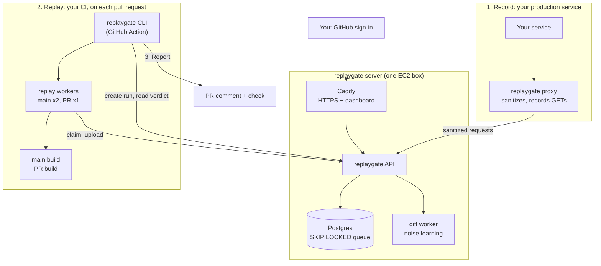
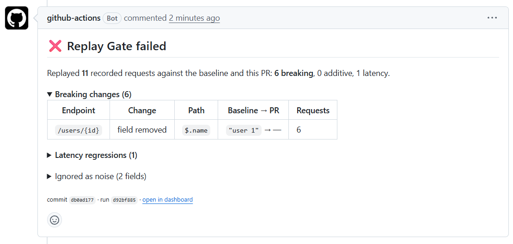
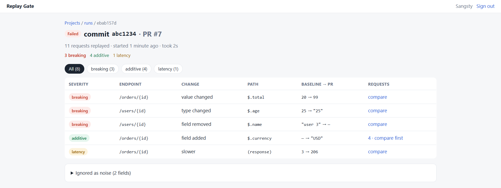

# replaygate

Traffic Replay Regression Gate: record sanitized API traffic through a reverse
proxy, replay it against the baseline (main) and candidate (PR) builds, diff
the responses, and fail the pull request with a readable report when a
breaking change is found.

## Architecture



How a check works: the proxy records sanitized production GETs. On a pull request
the Action replays the most frequent ones three times: against `main` twice and
against the PR once. Fields that differ between the two `main` replays (timestamps,
request ids, etags) are learned as noise and ignored. Everything else that differs
between `main` and the PR is a finding, ranked breaking, additive or latency, and
the check fails on breaking ones with a report on the PR. Credentials for the
services under test stay on the CI runner and are never uploaded.

> Status: Phase 4 (evaluation in `docs/evaluation.md`, deployment in `deploy/README.md`).

## Demo

A pull request that drops a field from `/users/{id}` fails the check, and the
Action comments on the PR with what changed
([the live PR](https://github.com/Sangsty/replaygate-demo-service/pull/1)):



The same run in the dashboard, with findings grouped by severity and the fields
learned as noise collapsed at the bottom:



## Quick start

```bash
cp .env.example .env
make up                      # Postgres 16 in Docker
go mod tidy                  # first run only: resolves deps and writes go.sum
make test                    # go test -race ./...
make bootstrap NAME=demo     # prints RG_PROJECT_ID and RG_API_KEY once
# paste both values into .env, and set RG_UPSTREAM_URL to your service
make api                     # terminal 1
make proxy                   # terminal 2
curl -H 'Authorization: Bearer x' 'http://localhost:8081/your/path'
```

Only GET requests are recorded. Authorization, cookies and any configured
headers, query params and JSON paths are redacted before anything leaves the
proxy. Production response bodies are never stored.

## Phase 2: replay and diff

A run replays the most-hit recorded requests three times: `baseline_a` and
`baseline_b` against the baseline (main) build, and `candidate` against the PR
build. Fields that differ between A and B are learned as noise and ignored;
everything else in A is diffed against the candidate.

```bash
./scripts/e2e.sh        # full demo with seeded bugs; needs `make up` first
```

Manual flow (three terminals plus the API):

```bash
make api                                                    # also runs the diff worker
curl -s -X POST -H "Authorization: Bearer $RG_API_KEY" \
  -H 'Content-Type: application/json' \
  "$RG_API_URL/v1/projects/$RG_PROJECT_ID/runs" -d '{"commit_sha":"abc1234"}'
RG_VARIANT=baseline_a RG_TARGET_URL=http://localhost:3000 RG_IDLE_EXIT=10s make worker
RG_VARIANT=baseline_b RG_TARGET_URL=http://localhost:3000 RG_IDLE_EXIT=10s make worker
RG_VARIANT=candidate  RG_TARGET_URL=http://localhost:3001 RG_IDLE_EXIT=10s make worker
curl -s -H "Authorization: Bearer $RG_API_KEY" \
  "$RG_API_URL/v1/projects/$RG_PROJECT_ID/runs/<run_id>"
```

Replay credentials for the target go in `RG_REPLAY_AUTH` on the worker (for
example `Bearer <token>`). They stay in that process and are never uploaded.
A run is `errored`, not `passed`, when the baseline did not answer.

## Phase 3: GitHub Action, dashboard

### Gate a pull request

`replaygate run` does a whole check from one command: it creates a run, replays
the recorded traffic against both builds, waits for the verdict, prints a
summary, writes the job summary, and posts (or edits) one comment on the pull
request. The GitHub Action wraps it. See `docs/replay-gate.example.yml` for a
complete workflow; the heart of it is:

```yaml
- uses: Sangsty/replaygate@main
  with:
    api-url: ${{ vars.REPLAYGATE_API_URL }}
    project-id: ${{ vars.REPLAYGATE_PROJECT_ID }}
    api-key: ${{ secrets.REPLAYGATE_API_KEY }}
    baseline-url: http://localhost:3001   # main branch build, already running
    candidate-url: http://localhost:3002  # PR build, already running
```

Exit status: `0` passed, `1` a regression was found, `2` no verdict (bad
configuration, API unreachable, baseline did not answer, timeout). An `errored`
run never shows as a pass. Failing to post the comment is a warning, not a
failure. Pull requests from forks get no secrets from GitHub, so the check
cannot run for them; that is GitHub's rule, not a limit of this tool.

Try the whole thing locally, with seeded bugs and no GitHub:

```bash
make up && bash scripts/e2e.sh
```

### Dashboard

Sign in with GitHub, open a project, see its runs, and click any finding to see
the baseline and PR responses side by side. Fields the run learned to ignore are
greyed out, so a visible difference that is not a finding is explained.

1. Create a GitHub OAuth app (Settings, Developer settings, OAuth Apps). For
   local use the homepage is `http://localhost:5173` and the callback URL is
   `http://localhost:5173/auth/github/callback`.
2. Put the client id and secret in `.env`, plus `RG_JWT_SECRET`
   (`openssl rand -base64 48`) and `RG_PUBLIC_URL`. See `.env.example`.
3. Give yourself access, then start everything:

```bash
make bootstrap NAME=my-service OWNER=<your-github-login>   # prints the project id and API key
make api                  # terminal 1
make web-install          # first time only
make web-dev              # terminal 2, http://localhost:5173
```

Access: you can open a project if you own it or if `bootstrap -owner` (or a row
in `project_members`) names your GitHub login. Sessions are a signed JWT in an
HttpOnly, SameSite=Lax cookie, valid for 24 hours, and can only read. Every
write endpoint requires the project API key.

Checks: `make web-test` (types and unit tests), `make web-build`.

## Phase 4: evaluation

How good is the gate? `make eval` answers with measurements instead of claims. It
runs the real API, diff worker, replay workers and gate in one process against a
scratch Postgres database (`rg_eval`, created and dropped for you), and writes
`docs/evaluation.md`:

```bash
make up
make eval            # about a minute; extra flags: make eval ARGS="-fp-runs 100"
make bench           # Go micro-benchmarks for the diff engine
```

What it measures:

1. **Seeded bugs.** A synthetic shop service (`internal/evalapp`) has ten seeded
   regressions, one per run: field removed, type changed, value changed, status
   changed, nested field removed, array truncated, null introduced, field
   renamed, precision lost, error on an edge-case query. A bug is *caught* when
   the check fails and *named* when the report lists the right endpoint, kind and
   path. Two safe changes (an added field, reordered keys) must not fail.
2. **False alarms.** The same build is compared with itself, with and without
   noise learning, and with a field that flips rarely. The report gives the rate
   with a 95% Wilson interval.
3. **Throughput.** A clean check of 1,000 and 10,000 recorded requests: three
   replays each, stored and diffed.

The numbers describe the machine and setup written at the top of
`docs/evaluation.md`; read its "Limits" section before quoting them. The Go test
`TestEvaluationEndToEnd` runs a small version of all of this in CI, so a change
that stops the gate catching one of the ten bugs cannot merge.

## Phase 4b: deploy and release

- **Server:** `deploy/README.md` is the step-by-step guide for one EC2 box:
  Postgres, the API and Caddy (automatic HTTPS) in Docker Compose
  (`docker-compose.prod.yml`). `deploy/init-env.sh` generates the secrets and
  `deploy/compose.sh` wraps the compose command.
- **Demo data:** `scripts/seed-demo.sh` records traffic from a demo service into
  your server and runs one failing and one passing check, so the dashboard is
  not empty.
- **Release binary:** pushing a tag such as `v0.1.0` runs `.github/workflows/release.yml`,
  which publishes `replaygate` for linux and macOS (amd64, arm64) with a
  `checksums.txt`. The Action downloads it and verifies the SHA-256 when given
  `version: v0.1.0`; without `version` it builds from source, as before.
- **Checks:** `scripts/test-install-gate.sh` tests the installer (checksum
  mismatch, hostile version strings), and `scripts/check-yaml.py` validates the
  Action and workflow files, both in CI.
